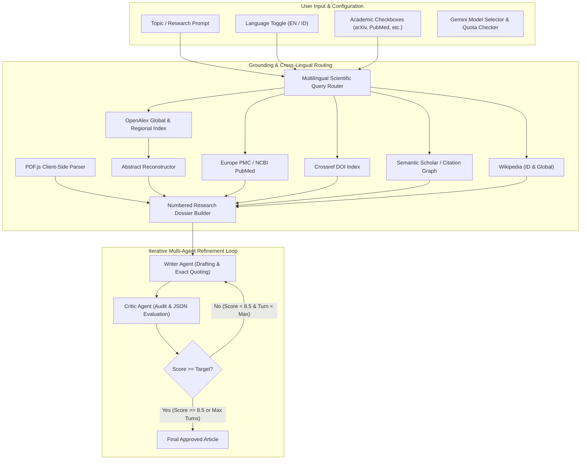

# 🛠️ Developer Guide: Gemini Agentic Studio Architecture & Engineering

This guide provides technical contributors, software engineers, and AI researchers with a comprehensive reference for the architecture, codebase, API integrations, and test automation of **Gemini Agentic Studio**.

---

## 📑 Table of Contents
1. [Architecture Overview](#-architecture-overview)
2. [Repository Structure](#-repository-structure)
3. [Dual-Implementation Pattern](#-dual-implementation-pattern)
4. [Academic Literature Grounding Engine](#-academic-literature-grounding-engine)
   - [OpenAlex API & Inverted Index Reconstruction](#1-openalex-api--inverted-index-reconstruction)
   - [Europe PMC / NCBI PubMed Integration](#2-europe-pmc--ncbi-pubmed-integration)
   - [Semantic Scholar & Fallback Strategy](#3-semantic-scholar--fallback-strategy)
   - [Crossref 150M+ DOI Catalog](#4-crossref-150m-doi-catalog)
   - [Wikipedia REST API](#5-wikipedia-rest-api)
   - [Client-Side PDF Parsing (PDF.js)](#6-client-side-pdf-parsing-pdfjs)
5. [Cross-Lingual Query Routing](#-cross-lingual-query-routing)
6. [Verbatim Quotation & CTRL+F Standard](#-verbatim-quotation--ctrlf-standard)
7. [Two-Agent Prompt Engineering & Structured Outputs](#-two-agent-prompt-engineering--structured-outputs)
8. [Client-Side Quota Probing System](#-client-side-quota-probing-system)
9. [Development Setup & Local Environment](#-development-setup--local-environment)
10. [Test Automation Suite (Playwright)](#-test-automation-suite-playwright)
11. [Extension Guide: Adding New Sources & Models](#-extension-guide-adding-new-sources--models)

---

## 🏛️ Architecture Overview

Gemini Agentic Studio employs a **Grounding-First Multi-Agent Architecture**:



---

## 📁 Repository Structure

```text
anAgenticApp/
├── index.html              # Standalone web app (Vanilla JS, Tailwind, Marked, PDF.js)
├── dev_pipeline.py         # Python CLI multi-agent orchestrator (google-genai, rich, pydantic)
├── test_browser.py         # Headless/headed Playwright test suite with assertion checks
├── requirements.txt        # Python package dependencies
├── .env                    # Local environment variables (GEMINI_API_KEY)
├── .gitignore              # Ignored files (.env, __pycache__, test_screenshots, etc.)
├── README.md               # Quickstart and project intro
├── USER_GUIDE.md           # End-user reference manual
├── DEVELOPER_GUIDE.md      # Technical architecture & developer reference (this file)
├── output/                 # Output directory for generated markdown reports
└── test_screenshots/      # Automated screenshot captures generated during test runs
```

---

## ⚖️ Dual-Implementation Pattern

The system provides identical capabilities in two environments:

| Component | Web Application (`index.html`) | Python CLI (`dev_pipeline.py`) |
| :--- | :--- | :--- |
| **Runtime** | Modern Browser (ES2022+) | Python 3.10+ |
| **API Client** | Direct `fetch()` to `generativelanguage.googleapis.com/v1beta` | Google's official `google-genai` SDK |
| **PDF Extraction** | Client-side `pdfjsLib` (WebAssembly/Canvas-less) | `pypdf` |
| **UI / Display** | Tailwind CSS, Marked.js, Prism.js | `rich` (Console, Panel, Markdown, Table) |
| **Data Storage** | Browser `localStorage` | `.env` and local filesystem |
| **Critic Schema** | In-prompt JSON Schema with regex cleaning | Pydantic `BaseModel` with strict typing |

---

## 🔬 Academic Literature Grounding Engine

All academic literature retrieval occurs **directly via open academic REST APIs** without requiring paid aggregators or proprietary scrapers.

### 1. OpenAlex API & Inverted Index Reconstruction
- **Endpoint**: `https://api.openalex.org/works`
- **Polite Pool**: Requests include `mailto=agenticapp.research@gmail.com` to use OpenAlex's fast polite pool rate limits.
- **Abstract Reconstruction Algorithm**: OpenAlex stores abstracts as an inverted index (`abstract_inverted_index: { "word": [positions] }`) to optimize metadata indexing. The application reconstructs the verbatim author abstract:

```python
def reconstruct_abstract(inverted_index: Optional[Dict[str, List[int]]]) -> str:
    """Reconstruct verbatim abstract from OpenAlex inverted index."""
    if not inverted_index or not isinstance(inverted_index, dict):
        return ""
    words: Dict[int, str] = {}
    for word, positions in inverted_index.items():
        if isinstance(positions, list):
            for pos in positions:
                words[pos] = word
    if not words:
        return ""
    sorted_positions = sorted(words.keys())
    return " ".join(words[p] for p in sorted_positions).strip()
```

### 2. Europe PMC / NCBI PubMed Integration
- **Primary Endpoint**: `https://www.ebi.ac.uk/europepmc/webservices/rest/search?query={topic}&resultType=core&format=json`
- **Why Europe PMC?**: Unlike NCBI E-utilities (which enforce strict origin blocking and rate limits), Europe PMC supports open CORS (`origin=*`) and returns complete `abstractText` strings in core mode.
- **Resilient NCBI Fallback**: If Europe PMC fails, the pipeline queries NCBI's `esearch.fcgi` and `esummary.fcgi` endpoints.

### 3. Semantic Scholar & Fallback Strategy
- **Direct Endpoint**: `https://api.semanticscholar.org/graph/v1/paper/search?query={topic}&limit=4&fields=title,authors,year,citationCount,url,abstract`
- **CORS / Rate Limit Fallback**: In browser environments where direct requests may be CORS-restricted, the system automatically falls back to an OpenAlex citation-ranked query (`sort=cited_by_count:desc`).

### 4. Crossref 150M+ DOI Catalog
- **Endpoint**: `https://api.crossref.org/works?query={topic}&rows=4&mailto={email}`
- Resolves official DOI records, publishers, author family names, and publication years.

### 5. Wikipedia REST API
- Regional Search: `https://{lang}.wikipedia.org/w/api.php?action=query&list=search&srsearch={query}&format=json&origin=*`
- Extract Endpoint: `https://{lang}.wikipedia.org/api/rest_v1/page/summary/{slug}`

### 6. Client-Side PDF Parsing (PDF.js)
In `index.html`, users can upload local PDF files:
```javascript
const pdf = await pdfjsLib.getDocument({ data: arrayBuffer }).promise;
const maxPages = Math.min(pdf.numPages, 15);
for (let i = 1; i <= maxPages; i++) {
  const page = await pdf.getPage(i);
  const textContent = await page.getTextContent();
  extractedText += `\n[Page ${i}]\n` + textContent.items.map(item => item.str).join(" ");
}
```

---

## 🌐 Cross-Lingual Query Routing

When a user submits a query in non-English (such as Bahasa Indonesia), global literature repositories require English scientific keywords to yield relevant publications.

### Two-Tier Resolution Pipeline:
1. **Tier 1: LLM-Based Query Formulation**:
   Queries `gemini-3.5-flash-lite` with a zero-shot prompt requesting a structured JSON response:
   ```json
   {
     "global_stem": "speech perception auditory processing",
     "regional": "Persepsi wicara",
     "is_indonesian": true
   }
   ```
2. **Tier 2: Static Heuristic / Dictionary Fallback**:
   If the LLM call times out or encounters network limits, a built-in scientific dictionary map handles primary terminology (e.g., `persepsi wicara` → `speech perception`, `rekayasa perangkat lunak` → `software engineering`).

---

## 🎯 Verbatim Quotation & CTRL+F Standard

To ensure citations can be audited without friction, the agents follow strict formatting rules:

### Rules Enforced in Agent Prompts
1. **Quotation Pattern**: `"... exact text ..."` immediately followed by the bracketed citation number `[n]`:
   ```markdown
   "While the perception task dynamically uses all frequencies with more prominent peaks..." [4]
   ```
2. **Character-for-Character Verbatim**:
   The text inside the quotation marks MUST match the source abstract character-for-character. Paraphrasing within quotation marks is strictly prohibited.
3. **Bibliography Structure**:
   At the end of the text, a numbered bibliography must be provided:
   ```markdown
   ## 📚 Referensi & Sumber Terkutip
   [1] Author A, Author B (Year). *Title*. Venue. [Link](url)
   [2] Author C (Year). *Title*. Venue. [Link](url)
   ```
4. **Critic Audit**:
   The Critic Agent explicitly scans for:
   - Quotation format compliance (`"..." [n]`)
   - Exact match against the dossier abstracts
   - Inclusion of all cited numbers in the ending bibliography

---

## 🤖 Two-Agent Prompt Engineering & Structured Outputs

### Critic Result Schema (Pydantic / JSON)
```python
class CritiqueResult(BaseModel):
    score: float = Field(description="Rating from 1.0 to 10.0")
    status: str = Field(description="'APPROVED' if score >= 8.5 else 'NEEDS_REVISION'")
    strengths: list[str] = Field(description="List of positive aspects of the draft")
    weaknesses: list[str] = Field(description="List of weak areas or flaws found")
    actionable_revisions: list[str] = Field(description="Clear, numbered instructions for the writer")
```

In the browser implementation (`index.html`), structured JSON is returned and parsed with regex fences stripped (`clean.replace(/^```(?:json)?\s*/i, "").replace(/\s*```$/i, "")`).

---

## 🚦 Client-Side Quota Probing System

The `checkAllModelQuotas` function tests model availability directly from the client without risking pipeline execution:

```javascript
for (const m of ALL_MODELS) {
  const url = `https://generativelanguage.googleapis.com/v1beta/models/${m.id}:generateContent?key=${apiKey}`;
  const res = await fetch(url, {
    method: "POST",
    headers: { "Content-Type": "application/json" },
    body: JSON.stringify({ contents: [{ parts: [{ text: "ping" }] }] })
  });
  if (res.status === 200) availableModels.push(m);
  else if (res.status === 429) exhaustedModels.push(m);
}
```
Models are dynamically sorted into `🟢 Available (Active Quota)` and `🔴 Quota Reached (Daily limit)` groups in the UI select element.

---

## 💻 Development Setup & Local Environment

### 1. Prerequisites
- Python 3.10 or higher
- A modern web browser (Chromium, Firefox, or WebKit)
- A Gemini API Key from [Google AI Studio](https://aistudio.google.com/)

### 2. Installation
```bash
git clone https://github.com/ivanadriman/anAgenticApp.git
cd anAgenticApp

python -m venv venv
# Windows:
venv\Scripts\activate
# Linux/macOS:
source venv/bin/activate

pip install -r requirements.txt
playwright install chromium
```

### 3. Local Web Server
You can open `index.html` directly as a file, or serve it locally:
```bash
python -m http.server 8000
```
Navigate to `http://localhost:8000/`.

---

## 🧪 Test Automation Suite (Playwright)

The project includes an end-to-end automated browser test suite in [`test_browser.py`](file:///c:/Users/kiris/OneDrive/Documents/AI%20Projects/anAgenticApp/test_browser.py).

### Running Browser Tests
```bash
python test_browser.py
```

### Test Assertions
1. **Test Case 1**: Toggles language switcher (`🇬🇧 EN` ↔ `🇮🇩 ID`) and verifies localized labels.
2. **Test Case 2**: Injects test API key, selects all 6 literature sources, and fills an Indonesian topic.
3. **Test Case 3**: Executes the pipeline and monitors the live research progression card.
4. **Test Case 4**: Verifies global STEM translations, Indonesian Writer Card count, and clickable scholarly links.
5. **Test Case 5**:
   - Asserts quotes match `r'["“][^"”]{8,}["”]\s*\[\d+\]'`.
   - Asserts the presence of the ending references section.
   - Asserts all citation numbers `[n]` in quotes map to numbered entries in the bibliography.

Screenshots of every stage are captured and stored in `test_screenshots/`.

---

## 🔌 Extension Guide: Adding New Sources & Models

### Adding a New Academic Source
To add a new database (e.g., *CORE*, *DOAJ*, or *IEEE Xplore*):
1. **Define the Fetcher**: In both `index.html` and `dev_pipeline.py`, write an async fetcher returning:
   ```typescript
   interface ScholarlyItem {
     source: string;
     title: string;
     authors: string;
     year: string | number;
     url: string;
     abstract?: string;
   }
   ```
2. **Add Checkbox**: Add a checkbox in `index.html` under `#groundingOptions`.
3. **Connect in Dossier Builder**: Include the source in `collectScholarlyDossier` and `build_scholarly_dossier` with sequential `[Source n]` numbering.

### Adding a New Gemini Model
In `index.html`, add the model definition to `ALL_MODELS`:
```javascript
{ id: "gemini-3.5-pro", label: "gemini-3.5-pro (Production Preview)" }
```
And in `dev_pipeline.py`, add the model name to `argparse` choices.
