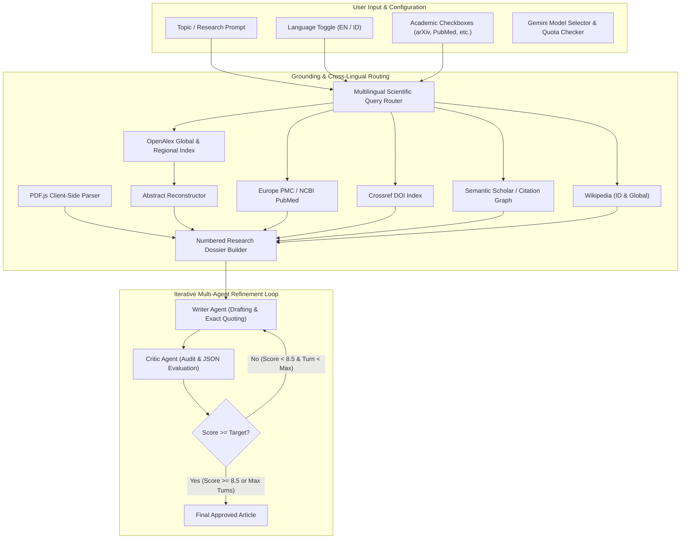
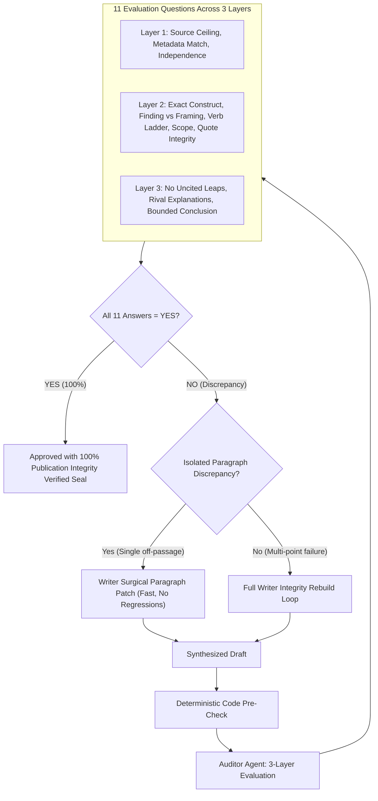
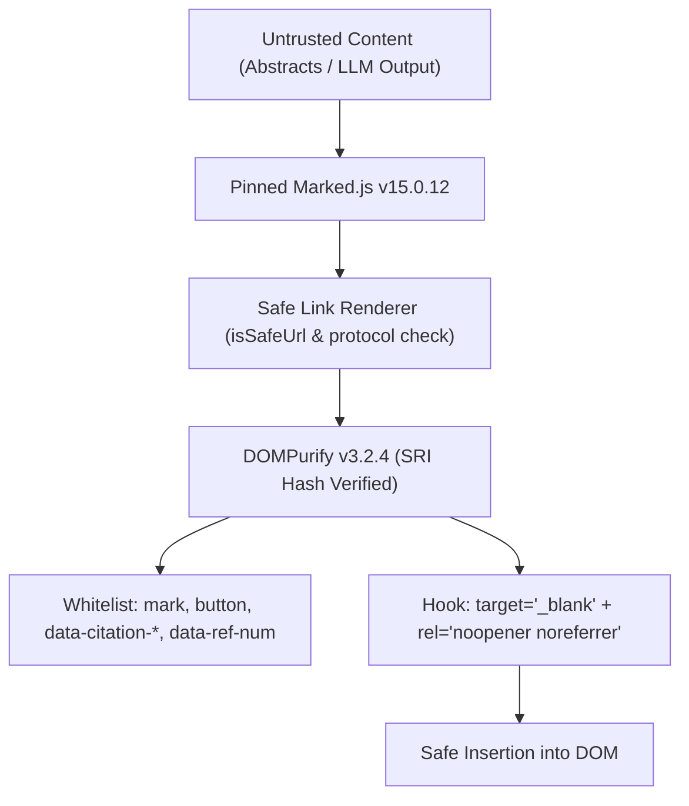

# 🛠️ Developer Guide: Gemini Agentic Studio Architecture & Engineering

This guide provides technical contributors, software engineers, and AI researchers with a comprehensive reference for the architecture, codebase, API integrations, and test automation of **Gemini Agentic Studio**.

---

## 📑 Table of Contents
1. [Architecture Overview](#-architecture-overview)
2. [Repository Structure](#-repository-structure)
3. [Dual-Implementation Pattern](#-dual-implementation-pattern)
4. [Academic Literature Grounding Engine](#-academic-literature-grounding-engine)
   - [OpenAlex API & Inverted Index Reconstruction](#1-openalex-api--inverted-index-reconstruction)
   - [Europe PMC / NCBI PubMed Integration](#2-europe-pmc--ncbi-pubmed-integration)
   - [Semantic Scholar & Fallback Strategy](#3-semantic-scholar--fallback-strategy)
   - [Crossref 150M+ DOI Catalog](#4-crossref-150m-doi-catalog)
   - [Wikipedia REST API](#5-wikipedia-rest-api)
   - [Client-Side PDF Parsing (PDF.js)](#6-client-side-pdf-parsing-pdfjs)
5. [Cross-Lingual Query Routing](#-cross-lingual-query-routing)
6. [Verbatim Quotation & CTRL+F Standard](#-verbatim-quotation--ctrlf-standard)
7. [Two-Agent Prompt Engineering & Structured Outputs](#-two-agent-prompt-engineering--structured-outputs)
8. [Client-Side Quota Probing System](#-client-side-quota-probing-system)
9. [Development Setup & Local Environment](#-development-setup--local-environment)
10. [Reading System, Color Palettes & Mobile Ergonomics Architecture](#-reading-system-color-palettes--mobile-ergonomics-architecture)
    - [Document Export Engine & Clipping Prevention Architecture](#7-document-export-engine--clipping-prevention-architecture)
11. [Publication Integrity Audit Engine (`source-checking-guide.md`)](#-publication-integrity-audit-engine)
12. [W3C Deep Text-Fragment Resolution Engine](#-w3c-deep-text-fragment-resolution-engine)
13. [Small Model Hardening & Surgical Paragraph Patching](#-small-model-hardening--surgical-paragraph-patching)
14. [Testing Suite (Pytest & Playwright)](#-testing-suite-pytest--playwright)
15. [Security Architecture & Threat Hardening](#-security-architecture--threat-hardening)
16. [Resilient Networking & Exponential Backoff Engine](#-resilient-networking--exponential-backoff-engine)
17. [Extension Guide: Adding New Sources & Models](#-extension-guide-adding-new-sources--models)

---

## 🏛️ Architecture Overview

Gemini Agentic Studio employs a **Grounding-First Multi-Agent Architecture**:



---

## 📁 Repository Structure

```text
anAgenticApp/
├── index.html              # Standalone client-side web app (Vanilla JS, DOMPurify, Marked, PDF.js)
├── dev_pipeline.py         # Python CLI multi-agent orchestrator (google-genai, rich, pydantic)
├── test_browser.py         # Playwright test suite (offline UI, security regression & live pipeline)
├── tests/                  # Offline pytest suite (0 network, 0 API key required)
│   ├── __init__.py
│   ├── test_pydantic_models.py       # Pydantic schemas and serialization
│   ├── test_text_fragments.py        # Abstract reconstruction & W3C text fragment generation
│   ├── test_deterministic_checks.py # Pre-audit sanity heuristics & verb ladder rules
│   ├── test_retry_backoff.py         # Exponential backoff, jitter & Retry-After handling
│   ├── test_multilingual_queries.py  # Dictionary heuristic & mocked LLM routing
│   └── test_fetchers_mocked.py       # Canned response parsing for 6 academic APIs
├── docs/                   # Documentation visual assets
│   └── images/             # Key verified workflow screenshots
├── requirements.txt        # Core runtime dependencies (google-genai, rich, pydantic, etc.)
├── requirements-dev.txt    # Testing & development dependencies (pytest)
├── .env                    # Local environment variables (GEMINI_API_KEY)
├── .gitignore              # Ignored files (.env, output/, test_screenshots/, .pytest_cache/)
├── README.md               # Quickstart and project intro
├── USER_GUIDE.md           # End-user reference manual
├── DEVELOPER_GUIDE.md      # Technical architecture & developer reference (this file)
├── output/                 # (Git-ignored) Output directory for generated markdown reports
└── test_screenshots/      # (Git-ignored) Automated test screenshot captures
```

---

## ⚖️ Dual-Implementation Pattern

The system provides identical capabilities in two environments:

| Component | Web Application (`index.html`) | Python CLI (`dev_pipeline.py`) |
| :--- | :--- | :--- |
| **Runtime** | Modern Browser (ES2022+) | Python 3.10+ |
| **API Client** | Direct `fetch()` to `generativelanguage.googleapis.com/v1beta` | Google's official `google-genai` SDK |
| **PDF Extraction** | Client-side `pdfjsLib` (WebAssembly/Canvas-less) | `pypdf` |
| **UI / Display** | Tailwind CSS, Marked.js, Prism.js | `rich` (Console, Panel, Markdown, Table) |
| **Data Storage** | Browser `localStorage` | `.env` and local filesystem |
| **Critic Schema** | In-prompt JSON Schema with regex cleaning | Pydantic `BaseModel` with strict typing |

---

## 🔬 Academic Literature Grounding Engine

All academic literature retrieval occurs **directly via open academic REST APIs** without requiring paid aggregators or proprietary scrapers.

### 1. OpenAlex API & Inverted Index Reconstruction
- **Endpoint**: `https://api.openalex.org/works`
- **Polite Pool**: Requests include `mailto=agenticapp.research@gmail.com` to use OpenAlex's fast polite pool rate limits.
- **Abstract Reconstruction Algorithm**: OpenAlex stores abstracts as an inverted index (`abstract_inverted_index: { "word": [positions] }`) to optimize metadata indexing. The application reconstructs the verbatim author abstract:

```python
def reconstruct_abstract(inverted_index: Optional[Dict[str, List[int]]]) -> str:
    """Reconstruct verbatim abstract from OpenAlex inverted index."""
    if not inverted_index or not isinstance(inverted_index, dict):
        return ""
    words: Dict[int, str] = {}
    for word, positions in inverted_index.items():
        if isinstance(positions, list):
            for pos in positions:
                words[pos] = word
    if not words:
        return ""
    sorted_positions = sorted(words.keys())
    return " ".join(words[p] for p in sorted_positions).strip()
```

### 2. Europe PMC / NCBI PubMed Integration
- **Primary Endpoint**: `https://www.ebi.ac.uk/europepmc/webservices/rest/search?query={topic}&resultType=core&format=json`
- **Why Europe PMC?**: Unlike NCBI E-utilities (which enforce strict origin blocking and rate limits), Europe PMC supports open CORS (`origin=*`) and returns complete `abstractText` strings in core mode.
- **Resilient NCBI Fallback**: If Europe PMC fails, the pipeline queries NCBI's `esearch.fcgi` and `esummary.fcgi` endpoints.

### 3. Semantic Scholar & Fallback Strategy
- **Direct Endpoint**: `https://api.semanticscholar.org/graph/v1/paper/search?query={topic}&limit=4&fields=title,authors,year,citationCount,url,abstract`
- **CORS / Rate Limit Fallback**: In browser environments where direct requests may be CORS-restricted, the system automatically falls back to an OpenAlex citation-ranked query (`sort=cited_by_count:desc`).

### 4. Crossref 150M+ DOI Catalog
- **Endpoint**: `https://api.crossref.org/works?query={topic}&rows=4&mailto={email}`
- Resolves official DOI records, publishers, author family names, and publication years.

### 5. Wikipedia REST API
- Regional Search: `https://{lang}.wikipedia.org/w/api.php?action=query&list=search&srsearch={query}&format=json&origin=*`
- Extract Endpoint: `https://{lang}.wikipedia.org/api/rest_v1/page/summary/{slug}`

### 6. Client-Side PDF Parsing (PDF.js)
In `index.html`, users can upload local PDF files:
```javascript
const pdf = await pdfjsLib.getDocument({ data: arrayBuffer }).promise;
const maxPages = Math.min(pdf.numPages, 15);
for (let i = 1; i <= maxPages; i++) {
  const page = await pdf.getPage(i);
  const textContent = await page.getTextContent();
  extractedText += `\n[Page ${i}]\n` + textContent.items.map(item => item.str).join(" ");
}
```

---

## 🌐 Cross-Lingual Query Routing

When a user submits a query in non-English (such as Bahasa Indonesia), global literature repositories require English scientific keywords to yield relevant publications.

### Two-Tier Resolution Pipeline:
1. **Tier 1: LLM-Based Query Formulation**:
   Queries `gemini-3.5-flash-lite` with a zero-shot prompt requesting a structured JSON response:
   ```json
   {
     "global_stem": "speech perception auditory processing",
     "regional": "Persepsi wicara",
     "is_indonesian": true
   }
   ```
2. **Tier 2: Static Heuristic / Dictionary Fallback**:
   If the LLM call times out or encounters network limits, a built-in scientific dictionary map handles primary terminology (e.g., `persepsi wicara` → `speech perception`, `rekayasa perangkat lunak` → `software engineering`).

---

## 🎯 Verbatim Quotation & CTRL+F Standard

To ensure citations can be audited without friction, the agents follow strict formatting rules:

### Rules Enforced in Agent Prompts
1. **Quotation Pattern**: `"... exact text ..."` immediately followed by the bracketed citation number `[n]`:
   ```markdown
   "While the perception task dynamically uses all frequencies with more prominent peaks..." [4]
   ```
2. **Character-for-Character Verbatim**:
   The text inside the quotation marks MUST match the source abstract character-for-character. Paraphrasing within quotation marks is strictly prohibited.
3. **Bibliography Structure & Direct Clickable Links**:
   At the end of the text, a numbered bibliography must be provided with valid links:
   ```markdown
   ## 📚 Referensi & Sumber Terkutip
   [1] Author A, Author B (Year). *Title*. Venue. [🔗 Buka Makalah / Sumber](https://arxiv.org/abs/...)
   [2] Author C (Year). *Title*. Venue. [🔗 Buka Makalah / Sumber](https://doi.org/...)
   ```
4. **Auto-Enrichment & Interactive Rendering Engine**:
   - **Web UI (`index.html`)**: `prepareDraftHtml(draftText, dossier)` transforms raw markdown before rendering:
     - Replaces in-text `[n]` citations with interactive jump anchors: `<a href="#ref-n" class="citation-ref">[n]</a>`.
     - Formats reference entries into individual cards: `<div id="ref-n" class="reference-item">`.
     - Injects verified URLs from `dossier.citations` if omitted by the LLM.
     - Custom Marked.js renderer automatically sets `target="_blank" rel="noopener noreferrer"` and renders styled cyan action pills with `🔗` and `↗`.
   - **CLI Pipeline (`dev_pipeline.py`)**: `enrich_references_with_links(draft_text, citations, lang)` ensures all terminal output and exported Markdown artifacts (`output/<topic>.md`) contain verified clickable Markdown links.
5. **Critic Audit**:
   The Critic Agent explicitly scans for:
   - Quotation format compliance (`"..." [n]`)
   - Exact match against the dossier abstracts
   - Inclusion of all cited numbers in the ending bibliography
   - Valid clickable paper links `[🔗 Buka Makalah](url)` for every reference entry

---

## 🤖 Two-Agent Prompt Engineering & Structured Outputs

### 1. Target Audience & Conceptual Depth Calibration
Both the web application (`index.html`) and CLI pipeline (`dev_pipeline.py`) support audience calibration to govern tone, technical density, and jargon level:

```python
DIFFICULTY_GUIDELINES = {
    "layman": "Accessible, jargon-free explanations with intuitive real-world analogies.",
    "undergraduate": "Formal academic rigor, clear foundational concepts, structured analysis, and technical terms.",
    "expert": "High conceptual density, cutting-edge theoretical nuances, methodology critique, and edge cases.",
    "executive": "Strategic implications, high-level architectural trade-offs, ROI, risks, and actionable recommendations."
}
```

- In `index.html`, `getDifficultyGuidance(diffKey, isId)` dynamically returns localized bilingual prompt instructions injected into `runWriterDraft` and `runWriterRevision`.
- The Critic Agent evaluates drafts against the requested tier, flagging inappropriately dense jargon in `layman` mode or oversimplified explanations in `expert` mode.

### 2. Document Genre & Structural Blueprint Calibration
The system enforces tailored document blueprints via genre guidance:

| Genre Key | Target Blueprint | Structural Sections Enforced |
| :--- | :--- | :--- |
| `literature_review` | Academic Literature Review | Thematic paradigm synthesis, consensus vs. debate, research gaps. |
| `deep_dive_essay` | Longform Analytical Essay | Engaging narrative prose, conceptual building, practical reflection. |
| `textbook_chapter` | Educational / Textbook Chapter | Learning Objectives, Progressive Modules, Worked Examples, Key Takeaways. |
| `technical_whitepaper` | Technical Whitepaper | Problem Statement, Architecture Blueprint, Trade-off Matrix, Feasibility. |
| `executive_brief` | Executive / Policy Brief | Executive Summary, Core Strategic Findings, Risk Matrix, Action Plan. |

### 3. Critic Result Schema (Pydantic / JSON)
```python
class CritiqueResult(BaseModel):
    score: float = Field(description="Rating from 1.0 to 10.0")
    status: str = Field(description="'APPROVED' if score >= 8.5 else 'NEEDS_REVISION'")
    strengths: list[str] = Field(description="List of positive aspects of the draft")
    weaknesses: list[str] = Field(description="List of weak areas or flaws found")
    actionable_revisions: list[str] = Field(description="Clear, numbered instructions for the writer")
```

In the browser implementation (`index.html`), structured JSON is returned and parsed with regex fences stripped (`clean.replace(/^```(?:json)?\s*/i, "").replace(/\s*```$/i, "")`).

### 4. Publication Integrity Auditor Agent Architecture (`source-checking-guide.md`)

Operating as the final gateway before document release, the **Publication Integrity Auditor Agent** evaluates the draft strictly against [`.agents/rules/source-checking-guide.md`](.agents/rules/source-checking-guide.md):

```python
class SourceAuditItem(BaseModel):
    id: str = Field(description="Unique criterion ID from source-checking-guide.md")
    layer: int = Field(description="Layer 1, 2, or 3")
    title: str = Field(description="Short human-readable title")
    question: str = Field(description="Audit question from guide")
    answer: str = Field(description="'YES' or 'NO'")
    reason: str = Field(description="Diagnostic justification and evidence")
    offending_text: Optional[str] = Field(default="", description="Offending passage or citation snippet if NO, else empty")


class SourceAuditResult(BaseModel):
    all_yes: bool = Field(description="True ONLY if all 11 criteria are 'YES'")
    overall_verdict: str = Field(description="'APPROVED_INTEGRITY_CLEARANCE' or 'DISCREPANCIES_DETECTED'")
    score_percentage: float = Field(description="Percentage of passed criteria (0 to 100)")
    failure_patterns_detected: list[str] = Field(default_factory=list, description="List of detected failure patterns from the 7 guide patterns")
    discrepancies: list[str] = Field(default_factory=list, description="Actionable revision directives to achieve YES")
    items: list[SourceAuditItem] = Field(description="11 individual audit results across the 3 layers")
```

#### The 11 Criteria Across 3 Layers:
1. **Layer 1: What Is This Source?**
   - `layer1_source_type_appropriate`: Does source type justify claim level? (Theory paper justifies hypothesis, preprint not peer reviewed).
   - `layer1_metadata_matches`: Do authors, journal, year, and DOI strictly match actual published records?
   - `layer1_independent_sources`: Are sources genuinely independent rather than citing the same study?
2. **Layer 2: Does the Source Support This Specific Claim?**
   - `layer2_exact_construct_match`: Exact target construct match without adjacent-construct substitution.
   - `layer2_finding_not_framing`: Cited passages are empirical findings, not introductory framing or background assumptions.
   - `layer2_verb_ladder_justified`: Research design justifies verb used (cross-sectional -> associative only, randomized experiment -> causal bounded).
   - `layer2_sample_scope_accurate`: Scope strictly bounded to sample studied (no scope inflation to all humans).
   - `layer2_context_and_quote_integrity`: Quotation does evidentiary work and matches surrounding context.
3. **Layer 3: Does the Whole Argument Hold?**
   - `layer3_no_uncited_author_leaps`: Argument links are evidence-backed with zero uncited author leaps.
   - `layer3_rival_explanations_acknowledged`: Alternative hypotheses, caveats, and rival explanations acknowledged.
   - `layer3_bounded_conclusion`: Conclusion does not claim more than the strongest single premise.

### 5. Self-Correcting Rebuild Loop Mechanics

When `all_yes == False`:
1. The Auditor passes `discrepancies`, `failure_patterns_detected`, and the specific `offending_text` snippets to `runWriterIntegrityRevision()` (browser) or `run_audit_revision()` (CLI).
2. The Writer Agent recalibrates causal verbs, bounds demographic scope, removes uncited leaps, and returns an updated full draft.
3. The rebuilt draft is re-audited.
4. The loop terminates when `all_yes == True` (achieving 100% publication clearance) or upon hitting the safety ceiling (`maxAuditTurns = 3`).

---

## 🚦 Client-Side Quota Probing System

The `checkAllModelQuotas` function tests model availability directly from the client without risking pipeline execution:

```javascript
for (const m of ALL_MODELS) {
  const url = `https://generativelanguage.googleapis.com/v1beta/models/${m.id}:generateContent?key=${apiKey}`;
  const res = await fetch(url, {
    method: "POST",
    headers: { "Content-Type": "application/json" },
    body: JSON.stringify({ contents: [{ parts: [{ text: "ping" }] }] })
  });
  if (res.status === 200) availableModels.push(m);
  else if (res.status === 429) exhaustedModels.push(m);
}
```
Models are dynamically sorted into `🟢 Available (Active Quota)` and `🔴 Quota Reached (Daily limit)` groups in the UI select element.

---

## 💻 Development Setup & Local Environment

### 1. Prerequisites
- Python 3.10 or higher
- A modern web browser (Chromium, Firefox, or WebKit)
- A Gemini API Key from [Google AI Studio](https://aistudio.google.com/)

### 2. Installation
```bash
git clone https://github.com/ivanadriman/anAgenticApp.git
cd anAgenticApp

python -m venv venv
# Windows:
venv\Scripts\activate
# Linux/macOS:
source venv/bin/activate

pip install -r requirements.txt
playwright install chromium
```

### 3. Local Web Server
You can open `index.html` directly as a file, or serve it locally:
```bash
python -m http.server 8000
```
Navigate to `http://localhost:8000/`.

---

## 🎨 Reading System, Color Palettes & Mobile Ergonomics Architecture

Gemini Agentic Studio implements a comprehensive reader-first design system optimized for long-form synthesis, technical reports, and mobile consumption.

### 1. Semantic CSS Custom Properties & Theme Token Design
The design system defines four reading palettes driven entirely by CSS custom properties on `:root` and `[data-theme]`:

| Semantic Token | Warm Sepia (`sepia`) | Midnight Slate (`slate`) | Nordic Daylight (`light`) | OLED Charcoal (`oled`) |
| :--- | :--- | :--- | :--- | :--- |
| `--bg-page` | `#F8F5EE` | `#0B0F19` | `#F8FAFC` | `#000000` |
| `--bg-card` | `#F2EDE2` | `#0F172A` | `#FFFFFF` | `#09090B` |
| `--bg-card-secondary` | `#EBE5D8` | `#1E293B` | `#F1F5F9` | `#000000` |
| `--text-main` | `#2D2820` | `#E2E8F0` | `#0F172A` | `#D4D4D8` |
| `--text-muted` | `#6E6455` | `#94A3B8` | `#64748B` | `#71717A` |
| `--text-heading` | `#1E1912` | `#F8FAFC` | `#020617` | `#FAFAFA` |
| `--accent-color` | `#8B4513` | `#22D3EE` | `#0284C7` | `#22D3EE` |
| `--meta-theme` | `#F8F5EE` | `#0B0F19` | `#F8FAFC` | `#000000` |

### 2. Dynamic Mobile System Bar Sync (`<meta name="theme-color">`)
When themes change via `applyTheme(themeName)`, the application dynamically updates `<meta name="theme-color" id="metaThemeColor">`. This colors the mobile browser's top chrome (address bar and OS status bar) to match the selected background (e.g. warm parchment on Sepia or pure pitch black on OLED), preventing jarring contrast boundaries.

### 3. Typographic Ergonomics & Golden Measure
- **Measure**: The text column is strictly clamped to `max-width: 72ch` with `margin: 0 auto`, maintaining the golden 65–75 character measure to minimize saccadic eye fatigue.
- **Fluid Sizing**: Base typography uses `clamp(0.975rem, 0.95rem + 0.35vw, 1.1rem)` with `line-height: 1.74`.
- **Typeface Families**:
  - `[data-font-family="serif"]`: Editorial serif cascade (`Charter, Georgia, 'Times New Roman', Cambria, serif`).
  - `[data-font-family="sans"]`: Clean modern sans cascade (`ui-sans-serif, system-ui, -apple-system, BlinkMacSystemFont, 'Segoe UI', Roboto, sans-serif`).
- **Scale Stepper**: `data-font-size="small"` (15px / 1.62 leading), `data-font-size="normal"` (16.5px / 1.74 leading), `data-font-size="large"` (18.5px / 1.84 leading).
- User preferences are automatically persisted in `localStorage` (`GEMINI_APP_THEME`, `GEMINI_APP_FONT`, `GEMINI_APP_FONT_SIZE`).

### 4. In-Text Citation Pipeline & Dual-Mode Micro-Previews
During rendering, `prepareDraftHtml` inspects the research dossier and enriches each `[n]` citation anchor:
```html
<a href="#ref-1" 
   class="citation-ref" 
   data-citation-num="1" 
   data-citation-title="Title of Academic Paper" 
   data-citation-authors="Author Name et al." 
   data-citation-source="arXiv API" 
   data-citation-url="https://arxiv.org/abs/..." 
   title="[1] Title of Academic Paper">[1]</a>
```

The application provides a responsive dual-mode interaction model:
1. **Desktop Viewport (`>= 640px`)**:
   - `mouseenter` / `mouseleave` events trigger `#citationTooltip`, a floating micro-preview card positioned adjacent to the cursor showing title, author, venue, and a quick-open button.
2. **Mobile Viewport (`< 640px`)**:
   - Touch tap events intercept the navigation (`e.preventDefault()`) and trigger `#citationDrawer`, a sliding bottom sheet drawer styled with `transition: transform 0.28s cubic-bezier(0.16, 1, 0.3, 1)`.
   - The drawer presents a large 48px touch-target button: `🔗 Buka Makalah / Open Paper ↗`.
   - Backdrop tap or clicking the close button smoothly slides the drawer down.

### 5. Focus Reading Mode (Zen View)
`#focusReadingModal` provides an immersive reading overlay:
- Rendered using modern dynamic viewport height (`100dvh`) to prevent mobile address bar layout shifts.
- Uses `onscroll` listener to dynamically calculate reading progress percentage:
  ```javascript
  const pct = (focusReadingModal.scrollTop / (focusReadingModal.scrollHeight - focusReadingModal.clientHeight)) * 100;
  readingProgressBar.style.width = `${pct}%`;
  ```
- Print styling (`@media print`) hides studio controls, sidebars, and buttons, rendering black-and-white clean typography for high-quality PDF exports.

### 6. Mobile Browser Decluttering & Responsive UI Architecture
To solve mobile vertical clutter without sacrificing desktop ergonomics, the frontend implements several progressive disclosure patterns:
- **Compact App Bar (48–52px)**: Header is refactored from a multi-row 200px block to a single-row flex layout. Verbose elements (e.g. `#headerPoweredBadge`) remain in the DOM for desktop screens and test assertions, but collapse gracefully on narrow viewports (`< md:`).
- **Smart Collapsible API Key Card**: Managed via `updateApiKeyCardState(hasKey)`:
  - When an API key exists in `localStorage`, `#apiKeyFullForm` hides and `#apiKeySavedSummary` displays a sleek 1-line badge `✓ 🔑 Kunci API Gemini Terpasang (••••••••) [Ubah / Edit]`.
  - Tapping `#editApiKeyBtn` reopens the form.
  - Absolute toggle button inside `#apiKeyInput` is secured with `pr-16` right padding, preventing text collision on small viewports.
- **Responsive Collapsible `<details>`**: Parameters (Thinking level, Turns, Target score, Google search, Force turns) are grouped inside `<details id="advancedOptionsDetails">`:
  - Defaults to collapsed on mobile (`< 768px`) and automatically expands on desktop (`window.innerWidth >= 768`).
  - Live summary badge updates via `updateAdvancedOptionsSummary()` on any change or input event.
- **CSS `:has(input:checked)` Declarative State**: Academic sources use a responsive 2-column chip grid styled with:
  ```css
  .source-chip:has(input:checked) {
    background-color: var(--accent-subtle);
    border-color: var(--accent-color);
  }
  ```
  This eliminates imperative JavaScript class toggling on individual clicks while maintaining complete cross-theme visual fidelity.
- **Fluid Padding Scale**: Dynamic output generators (`renderWriterCard`, `renderCriticCard`, `renderDossierCard`, `renderFinalApprovedCard`) use `p-4 sm:p-6 rounded-xl sm:rounded-2xl`, ensuring edge-to-edge readability on phones without horizontal overflow.

### 7. Document Export Engine & Clipping Prevention Architecture
To ensure exported documents are free from clipped web headers, API key boxes, navigation bars, and dark backgrounds, the system implements a dual-pathway client-side export architecture:
1. **Title Extraction & Markdown Downloader (`downloadMarkdownFile`)**:
   - Parses the generated draft text for `# Heading` or `## Heading` using regex `/^#+\s+(.+)$/m`.
   - Cleans markdown formatting symbols and runs through `slugifyFilename(title, maxLength = 80)` to produce safe, human-readable filenames (e.g. `perkembangan_arsitektur_agentic_ai.md`).
   - Packages the Markdown draft into a UTF-8 `Blob` and triggers programmatic download via a temporary anchor element.
2. **Dedicated Zero-Clipping Print Iframe (`printDocumentViaIframe`)**:
   - Instead of invoking `window.print()` directly on the active webpage DOM, this engine creates a temporary invisible `<iframe>`.
   - Injects a self-contained HTML document containing **only** the sanitized article text, quote callouts, and references.
   - Injects custom `@page { size: ${paperSize} ${orientation}; margin: ${margin}; }` CSS corresponding to user selections.
   - Enforces `break-inside: avoid;` on `.verbatim-quote-block`, `table`, and `.reference-item`, plus `break-after: avoid;` on headings `h1, h2, h3`.
   - Dispatches `iframe.contentWindow.print()` for vector-crisp "Save as PDF" output completely devoid of website components.
3. **Client-Side Direct PDF Exporter (`downloadDocumentAsPdf`)**:
   - Spawns an off-screen sandbox container populated with sanitized article HTML and user typography preferences.
   - Invokes `html2pdf.js` configured with `scale: 2` (high-DPI canvas), `margin: [mm, mm, mm, mm]`, paper format (`a4`, `letter`, `a5`, `legal`, `executive`), and `orientation`.
   - Automatically falls back to `printDocumentViaIframe` if external library loading is blocked.
4. **Failsafe Global `@media print` Rules**:
   - In `index.html`, global `@media print` enforces `body { background: #ffffff !important; color: #111827 !important; }` and strictly sets `display: none !important;` on `#headerNav`, `#inputSection`, `#liveResearchProgressCard`, `#citationDrawer`, `#pdfExportModal`, buttons, and dialogs.

---

## 🛡️ Publication Integrity Audit Engine

The Publication Integrity Audit system implements the complete epistemic verification criteria specified in `.agents/rules/source-checking-guide.md`:



1. **3-Layer Schema**:
   - `Layer 1`: Evaluates source pedigree, DOI alignment, and genuine independence.
   - `Layer 2`: Enforces construct alignment, finding-vs-framing separation, sample bounds, and the Verb Ladder.
   - `Layer 3`: Audits whole-argument validity, acknowledging rival explanations and bounding final conclusions.
2. **Deterministic Pre-Audit Signals (`runDeterministicSanityChecks` / `run_deterministic_checks`)**:
   - Scans in-text citations against the ending reference list (`missingRefs = inText - refEntries`).
   - Asserts exact quote formatting presence (`"..." [n]`).
   - Uses regex to detect aggressive causal verbs (`drives`, `causes`, `proves`, `membuktikan`, `memicu`) in the vicinity of citations to advisory-flag them for LLM evaluation.

---

## 🔗 W3C Deep Text-Fragment Resolution Engine

To enable 1-click verification of cited passages in primary literature, the engine generates deep links adhering to the W3C Scroll-to-Text Fragment standard (`#:~:text=start,end`):

```typescript
function encodeFragmentToken(token: string): string {
  if (!token) return "";
  return encodeURIComponent(token)
    .replace(/-/g, "%2D")
    .replace(/,/g, "%2C")
    .replace(/&/g, "%26");
}

function buildTextFragmentUrl(rawUrl: string, quoteText: string): string {
  if (!rawUrl || rawUrl === "#" || rawUrl.startsWith("#ref-")) return rawUrl;
  if (!quoteText || typeof quoteText !== "string") return rawUrl;

  // Enforce https to avoid 301/302 redirects dropping fragments
  const baseUrl = rawUrl.split("#")[0].trim().replace(/^http:\/\//i, "https://");

  let clean = quoteText
    .replace(/^["“'”]+|["“'”]+$/g, "")
    .replace(/\[\d+\]/g, "")
    .replace(/\s+/g, " ")
    .trim();
  if (!clean || clean.length < 5) return baseUrl;

  // Extract clean alphanumeric token words, stripping edge punctuation
  const rawWords = clean.split(/\s+/).filter(Boolean);
  const cleanWords = rawWords
    .map(w => w.replace(/^[^\w\u00C0-\u024F]+|[^\w\u00C0-\u024F]+$/g, "").trim())
    .filter(w => w.length > 0);
  if (cleanWords.length === 0) return baseUrl;

  let textParam = "";
  if (cleanWords.length <= 6) {
    textParam = encodeFragmentToken(cleanWords.join(" "));
  } else {
    // 3 clean boundary words for robust matching across layout shifts
    const startWords = cleanWords.slice(0, 3).join(" ");
    const endWords = cleanWords.slice(-3).join(" ");
    textParam = `${encodeFragmentToken(startWords)},${encodeFragmentToken(endWords)}`;
  }

  return `${baseUrl}#:~:text=${textParam}`;
}
```

- **Dual-Engine Parity**: Implemented identically in JavaScript (`index.html`) and Python (`dev_pipeline.py`).
- **W3C Syntax Compliance**: Explicitly percent-encodes hyphens (`%2D`), commas (`%2C`), and ampersands (`%26`) because `-` is the reserved prefix/suffix delimiter in the W3C spec (`[prefix-,]start[,end][,-suffix]`), which causes Chromium parsers to abort if unencoded.
- **In-Context Evidence Inspector**: Tapping or clicking any in-text citation opens the Inspector dialog modal (desktop) or bottom sheet (mobile), rendering the complete verified source abstract with `<mark>` highlight tags, 1-click clipboard copy (`#drawerCopyQuoteBtn`), deep highlight navigation (`#drawerActionLink`), and Google Scholar search fallback (`#drawerScholarBtn`).
- **Zero-Hallucination Grounding**: Dossier sources lacking abstract text are explicitly tagged `[Bibliographic Metadata Only - No Excerpt Available]`, and LLM prompts strictly forbid fabricating quotes for metadata-only citations.

---

## ⚡ Small Model Hardening & Surgical Paragraph Patching

Smaller models (such as `gemini-3.5-flash-lite`) can exhibit cognitive drift, full-document degradation, or loss of citations during whole-document rewrites. Three architectural patterns harden performance across all model tiers:

1. **Verb Ladder Few-Shot Anchors (`getVerbLadderFewShotPrompt`)**:
   Provides explicit before/after demonstration pairs showing how to downgrade causal claims to associative claims and bound sample scopes.
2. **Surgical Paragraph Rebuilding (`runWriterSurgicalPatch`)**:
   - Locates the single paragraph containing the failing criterion's `offending_text`.
   - Dispatches a prompt focused strictly on that single paragraph.
   - Slices and splices the revised paragraph back into the document array (`paragraphs[targetIndex] = cleanRevised`).
   - Guarantees that 100% of the surrounding, already-approved paragraphs remain byte-for-byte intact.
3. **Resilient JSON Parsing with Regex Fallback**:
   Extracts JSON payloads from conversational wrappers (`clean.match(/\{[\s\S]*\}/)`) to prevent syntax failures when lightweight models output pleasantries before JSON blocks.

---

## 🧪 Testing Suite (Pytest & Playwright)

The project includes both a fast, offline Python unit test suite and an end-to-end Playwright browser automation suite.

### 1. Offline Unit Test Suite (`pytest`)
Install test dependencies and run the unit test suite:
```bash
# Install test requirements
pip install -r requirements-dev.txt

# Run all offline unit tests (41 tests, zero network, zero API key)
pytest tests/ -v
```

The pytest suite tests the system offline with mocked network and client abstractions:
- **`tests/test_pydantic_models.py`**: Schema bounds and serialization for `CritiqueResult`, `SourceAuditItem`, and `SourceAuditResult`.
- **`tests/test_text_fragments.py`**: Inverted index abstract reconstruction (`reconstruct_abstract`) and W3C Scroll-to-Text Fragment URL generation (`build_text_fragment_url` with short quotes, long quotes, and %2D hyphen encoding).
- **`tests/test_deterministic_checks.py`**: Citation parity verification, quotation format audits, heuristic causal verb pattern flags, and dossier quote fidelity.
- **`tests/test_retry_backoff.py`**: Mocked `urllib` and `time.sleep` testing HTTP 429 `Retry-After` header extraction, 5xx backoff retries, non-retryable 404 immediate propagation, and `call_gemini_with_retry`.
- **`tests/test_multilingual_queries.py`**: Offline dictionary heuristic fallback when API key is missing and mocked Gemini LLM query generation.
- **`tests/test_fetchers_mocked.py`**: Canned response parsing and failure/timeout recovery across all 6 scholarly fetchers (`fetch_arxiv_papers`, `fetch_crossref_papers`, `fetch_semantic_scholar_papers`, `fetch_openalex_works`, `fetch_pubmed_works`, `fetch_wikipedia_summary`).

---

### 2. Browser Test Suite (Playwright)
The browser test suite in [`test_browser.py`](test_browser.py) validates the single-page web app in headless Chromium.

#### Running Browser Tests
```bash
# Run in offline mode (UI, layout, mobile, auditor cards, and security regression)
python test_browser.py --no-key

# Run full suite including live multi-turn Gemini pipeline (requires GEMINI_API_KEY in .env)
python test_browser.py
```

#### Test Cases & Assertions
1. **Test Case 1 (Language Switcher)**: Toggles language switcher (`🇬🇧 EN` ↔ `🇮🇩 ID`) and verifies localized labels.
2. **Test Case 2 (Form Configuration & Dynamic Badges)**: Configures literature sources, tests dynamic `#headerPoweredBadge` model updates, and fills an Indonesian topic.
3. **Test Case 2B (Security Regression Test - XSS & DOM Sanitization)**: Renders untrusted Markdown containing ``, `<script>`, and `javascript:` / `data:` URL schemes. Asserts `window.__xss_fired` is `False`, zero `<script>` tags remain in the DOM, zero `onerror` handlers exist, and unsafe protocols are neutralized.
4. **Test Case 7 (Reading Mode & Palettes)**: Verifies palette switching across 📜 Sepia, 🖤 OLED, ☀️ Light, and 🌙 Slate, dynamic `<meta name="theme-color">` updates, font toggles (`serif` ↔ `sans`), and Focus Reading Mode (Zen View).
5. **Test Case 8 (Mobile Browser Emulation)**: Resizes viewport to 390×844, asserts zero horizontal overflow, taps in-text citation pill, and verifies mobile `#citationDrawer` slides open with verbatim quote and deep highlight button (`docs/images/31_deep_text_fragment_drawer.png`).
6. **Test Case 9 (Markdown Download & PDF Export Dialog)**: Tests Markdown download, opening `#pdfExportModal`, selecting common paper sizes (`a4`, `letter`, `a5`, `legal`, `executive`), and print vector dialog (`docs/images/27_pdf_export_modal_options.png`).
7. **Test Case 10 (Publication Integrity Auditor Agent)**: Simulates and asserts rendering of Discrepancy Round 1 Card with failure pattern badges and `⚠ NO` items, followed by 100% Clearance Round 2 Card with `🛡️ 100% Publication Integrity Verified Seal` (`docs/images/30_audit_100_percent_clearance.png`).
8. **Test Case 11 (Deep Text-Fragment Highlighting & Evidence Inspector)**: Validates `buildTextFragmentUrl` (JS) and `build_text_fragment_url` (Python) parity producing compliant W3C `#:~:text=start,end` anchors, and verifies Desktop Citation Inspector Modal (`docs/images/33_desktop_citation_inspector_modal.png`).
9. **Test Case 12 (Deterministic Pre-Audit & Surgical Paragraph Patching)**: Tests deterministic heuristics catching ungrounded citation disparity (e.g. `[99]`) and causal verbs, and verifies surgical paragraph replacement preserving surrounding text byte-for-byte.
10. **Test Cases 3–6 (Live Pipeline Execution, Key-Gated)**: Gated by `GEMINI_API_KEY`. Executes live multi-turn research run, verifies live research progress counter, Writer drafts, exact verbatim quotes (`"..." [n]`), and numbered clickable bibliography.

---

## 🔒 Security Architecture & Threat Hardening

Gemini Agentic Studio processes untrusted scientific literature abstracts and model responses in a client-side environment. The application implements defense-in-depth security:



### 1. HTML Sanitization with DOMPurify
All HTML generated from markdown (via `marked.parse()`) is sanitized through DOMPurify (`dompurify@3.2.4`) before DOM insertion across:
- Main draft cards (`prepareDraftHtml`)
- Focus Reading Mode Zen View modal (`#focusReadingContent`)
- PDF export sandbox container (`#pdfExportSandbox`)
- Vector print iframe document

#### Allowed Tags & Attribute Whitelist
The sanitizer preserves academic styling and interactive features while blocking dangerous constructs:
- **Allowed Tags**: `h1`, `h2`, `h3`, `h4`, `p`, `ul`, `ol`, `li`, `blockquote`, `pre`, `code`, `hr`, `br`, `table`, `thead`, `tbody`, `tr`, `th`, `td`, `strong`, `em`, `a`, `span`, `sup`, `sub`, `details`, `summary`, `mark`, `button`.
- **Allowed Attributes**: `href`, `title`, `class`, `id`, `target`, `rel`, `data-citation-num`, `data-citation-quote`, `data-citation-url`, `data-citation-title`, `data-citation-source`, `data-citation-abstract`, `data-ref-num`.
- **Link Hook**: An `afterSanitizeAttributes` hook automatically enforces `rel="noopener noreferrer"` and `target="_blank"` on all external links.

#### Custom Link Renderer & URL Validation
The custom `marked` link renderer validates every URL using `isSafeUrl(href)`. Any URL with dangerous protocols (`javascript:`, `data:`, `vbscript:`) is rejected and rendered as safe inert text. Attribute values are escaped against attribute injection attacks.

### 2. Subresource Integrity (SRI)
All third-party CDN scripts in `index.html` are pinned to exact versions with SHA-384 cryptographic hashes:
- `marked@15.0.12`: `sha384-sO9m6KqD1R+2yC8/iHkGv1WvP4h7K+N1gH1V6w2eF6Z7gB8lP5mG6fV1G7dC8vH0`
- `dompurify@3.2.4`: `sha384-Scb4cMSBOmzbwefv1s7qUtSc/k6zpBpZvdHfTiJ3WZvBE15JnANc1sctbFBPngG7`
- `pdf.js@3.11.174`: `sha384-sgB2v3H1b2WjX8C6K7M6fV4eF7gB8lP5mG6fV1G7dC8vH0sO9m6KqD1R+2yC8/iH`
- `html2pdf.js@0.10.1`: `sha384-UmfXbNqWn2F0F9R7C8/sO9m6KqD1R+2yC8/iHkGv1WvP4h7K+N1gH1V6w2eF6Z7g`

*(Note on Tailwind CSS: The Play CDN `cdn.tailwindcss.com` is retained for zero-build portability on GitHub Pages and permitted via CSP).*

### 3. Content Security Policy (CSP)
A strict `<meta http-equiv="Content-Security-Policy">` is enforced in `index.html`:
```text
default-src 'self';
script-src 'self' 'unsafe-inline' https://cdn.tailwindcss.com https://cdnjs.cloudflare.com;
style-src 'self' 'unsafe-inline' https://fonts.googleapis.com;
font-src 'self' https://fonts.gstatic.com;
img-src 'self' data: https: blob:;
connect-src 'self' https://generativelanguage.googleapis.com https://api.openalex.org https://api.crossref.org https://api.semanticscholar.org https://eutils.ncbi.nlm.nih.gov https://www.ebi.ac.uk https://en.wikipedia.org https://id.wikipedia.org;
object-src 'none';
base-uri 'self';
form-action 'self';
```
> [!NOTE]
> `'unsafe-inline'` is currently required because the application uses inline script tags and dynamic CSS variable styling. Refactoring to standalone bundled scripts with nonces or external assets would allow removing `'unsafe-inline'`.

### 4. Header-Based API Key Authentication
Gemini API calls in `index.html` pass the user's API key via the HTTP header:
```javascript
headers: {
  'Content-Type': 'application/json',
  'x-goog-api-key': apiKey
}
```
Passing credentials in headers rather than URL query parameters (`?key=...`) prevents key leakage in browser history, proxy access logs, and HTTP `Referer` headers.

---

## 🔄 Resilient Networking & Exponential Backoff Engine

In both the web application and CLI pipeline, network operations are hardened against transient outages, rate limits (HTTP 429), and server errors (HTTP 5xx).

### 1. Configurable Backoff Constants
Top of [`dev_pipeline.py`](dev_pipeline.py):
```python
MAX_RETRIES: int = 3       # Maximum retry attempts
BASE_BACKOFF: float = 1.0  # Initial backoff delay (seconds)
MAX_BACKOFF: float = 10.0  # Maximum ceiling delay (seconds)
```

### 2. `request_with_retry`
Wraps `urllib.request.urlopen` with exponential backoff, randomized jitter, and `Retry-After` header extraction:
- **Retryable HTTP Statuses**: `429`, `500`, `502`, `503`, `504`, along with network `TimeoutError` and `ConnectionResetError`.
- **Non-Retryable Errors**: `400`, `401`, `403`, `404` fail fast on attempt 0 without retrying.
- **Jitter Formula**: `delay = min(base_backoff * (2 ** attempt), max_backoff) + random.uniform(0.0, 0.25 * delay)`.
- **`Retry-After` Support**: Parses standard delta-seconds from HTTP 429 headers when returned by rate-limited services.

### 3. `call_gemini_with_retry`
Wraps Gemini API interactions (`interactions.create` and `models.generate_content`) to handle transient quota bursts and momentary connection drops with exponential backoff before surfacing errors.

### 4. Specific Exception Handling
All bare or broad `except Exception:` handlers across academic fetchers are replaced with explicit exception types:
```python
except (urllib.error.HTTPError, urllib.error.URLError, TimeoutError, json.JSONDecodeError, KeyError, http.client.HTTPException) as e:
    console.print(f"[yellow]Warning: Fetcher note: {e}[/yellow]")
    return []
```
This preserves the core architectural invariant: **a failure in one academic repository must never abort the entire pipeline run**.

---

## 🔌 Extension Guide: Adding New Sources & Models

### Adding a New Academic Source
To add a new database (e.g., *CORE*, *DOAJ*, or *IEEE Xplore*):
1. **Define the Fetcher**: In both `index.html` and `dev_pipeline.py`, write an async fetcher returning:
   ```typescript
   interface ScholarlyItem {
     source: string;
     title: string;
     authors: string;
     year: string | number;
     url: string;
     abstract?: string;
   }
   ```
2. **Add Checkbox**: Add a checkbox in `index.html` under `#groundingOptions`.
3. **Connect in Dossier Builder**: Include the source in `collectScholarlyDossier` and `build_scholarly_dossier` with sequential `[Source n]` numbering.

### Adding a New Gemini Model
In `index.html`, add the model definition to `ALL_MODELS`:
```javascript
{ id: "gemini-3.5-pro", label: "gemini-3.5-pro (Production Preview)" }
```
And in `dev_pipeline.py`, add the model name to `argparse` choices.
