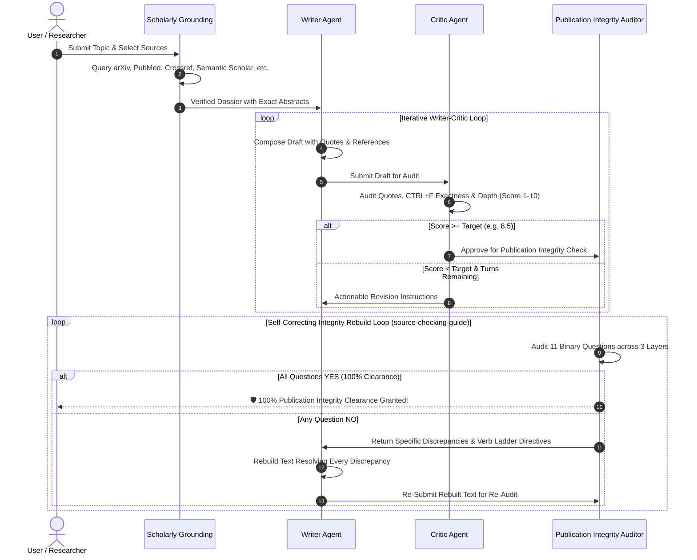

# 📖 User Guide: Gemini Agentic Studio

Welcome to **Gemini Agentic Studio** — an autonomous, iterative multi-agent research and composition platform powered by Google Gemini models. 

This guide provides end-users, students, researchers, technical writers, and content creators with comprehensive instructions on how to use the web application and the Python command-line interface (CLI).

> 💡 **Looking for practical scenarios, sample prompts, and configuration recommendations?** See the dedicated **[Real-World Use Cases Guide (USE_CASES.md)](USE_CASES.md)** for detailed walkthroughs of Academic Reviews, Technical Whitepapers, Executive Briefs, Educational Modules, and Confidential PDF Audits.

---

## 🌟 Table of Contents
1. [Overview & Core Concepts](#-overview--core-concepts)
2. [Getting Started](#-getting-started)
   - [Live Web Application (Recommended)](#1-live-web-application-recommended)
   - [Local Web Browser](#2-local-web-browser)
   - [Command-Line Interface (CLI)](#3-command-line-interface-cli)
3. [Language Switcher (English & Bahasa Indonesia)](#-language-switcher)
4. [API Key Setup & Security](#-api-key-setup--security)
5. [Model Selection & Quota Health Check](#-model-selection--quota-health-check)
6. [Scholarly Literature & Reference Grounding](#-scholarly-literature--reference-grounding)
   - [Grounding Repositories](#supported-academic-sources)
   - [Multilingual Scientific Lookup](#multilingual-scientific-lookup)
   - [Local Document Upload (PDF / TXT)](#local-document-upload)
7. [Advanced Pipeline Options (Target Audience & Document Genre)](#-advanced-pipeline-options-target-audience--document-genre)
   - [Target Difficulty & Audience Tiers](#target-difficulty--audience-tiers)
   - [Document Type & Reading Genres](#document-type--reading-genres)
   - [Thinking Depth & Turn Budget](#thinking-depth--turn-budget)
   - [Live Summary Badge & Mobile Layout](#live-summary-badge--mobile-layout)
8. [Verbatim Quotations & CTRL+F Verifiability](#-verbatim-quotations--ctrlf-verifiability)
9. [The Multi-Agent Collaboration Workflow](#-the-multi-agent-collaboration-workflow)
   - [Writer Agent](#writer-agent)
   - [Critic Agent](#critic-agent)
   - [Iterative Loop & Approval Threshold](#iterative-refinement-loop)
10. [Publication Integrity Audit & Self-Correcting Rebuild Loop (source-checking-guide.md)](#-publication-integrity-audit--self-correcting-rebuild-loop)
   - [The 3 Audit Layers & 11 Evaluation Criteria](#the-3-audit-layers--11-evaluation-criteria)
   - [The Verb Ladder & 7 Guarded Failure Patterns](#the-verb-ladder--7-guarded-failure-patterns)
   - [Self-Correction Loop: Automatic Rebuilding until 100% YES](#self-correction-loop-automatic-rebuilding-until-100-yes)
11. [Reading Ergonomics, Palettes & Focus Mode](#-reading-ergonomics-palettes--focus-mode)
   - [Four Reading Color Palettes](#1-four-reading-color-palettes)
   - [Typographic Ergonomics & Reader Toolbar](#2-typographic-ergonomics--reader-toolbar)
   - [Interactive Citation Micro-Previews & Mobile Bottom Sheet Drawer](#3-interactive-citation-micro-previews--mobile-bottom-sheet-drawer)
   - [Zen Mode Focus Reading Overlay](#4-zen-mode-focus-reading-overlay)
   - [Mobile Phone Streamlined Experience & Decluttering](#5-mobile-phone-streamlined-experience--decluttering)
12. [Exporting Documents (Markdown & Clean PDF with Paper Sizes)](#-exporting-documents-markdown--clean-pdf)
    - [Download as Markdown (.md) with Text Title](#1-download-as-markdown-md-with-actual-title)
    - [PDF Export with Zero Website Clipping](#2-pdf-export-with-zero-website-components-clipping)
    - [Common Paper Sizes: A4, Letter, A5, Legal, Executive](#3-supported-paper-sizes--layout-customization)
    - [Dual Export Pathways (Direct File vs. Vector Print)](#4-dual-export-pathways)
13. [CLI Usage & Command Reference](#-cli-usage--command-reference)
14. [Troubleshooting & FAQs](#-troubleshooting--faqs)

---

## 💡 Overview & Core Concepts

Traditional AI tools often produce content in a single shot without verification, leading to potential hallucinations, shallow synthesis, or untraceable claims.

**Gemini Agentic Studio** solves this through a synchronized two-agent architecture grounded in verified academic research:
- **Writer Agent**: Gathers peer-reviewed papers and encyclopedic records, writes an in-depth draft, embeds exact verbatim quotes, and compiles a complete bibliography.
- **Critic Agent**: Acts as an uncompromising peer reviewer and editor. It audits every claim, checks verbatim quotation accuracy against source abstracts, grades the draft on a 1.0 to 10.0 scale, and provides actionable revision items.
- **Academic Grounding Engine**: Queries global scientific indexes (arXiv, PubMed / Europe PMC, Crossref, Semantic Scholar, OpenAlex, Wikipedia) in real time before writing begins.

---

## 🚀 Getting Started

### 1. Live Web Application (Recommended)
You can access the live hosted version without installing anything:
👉 **[Launch Gemini Agentic Studio on GitHub Pages](https://ivanadriman.github.io/anAgenticApp/)**

### 2. Local Web Browser
1. Clone or download the repository:
   ```bash
   git clone https://github.com/ivanadriman/anAgenticApp.git
   ```
2. Double-click [`index.html`](file:///c:/Users/kiris/OneDrive/Documents/AI%20Projects/anAgenticApp/index.html) or open it in Google Chrome, Microsoft Edge, Mozilla Firefox, or Apple Safari.
3. No server or Node.js environment is required; the app runs entirely in your browser using modern Web APIs.

### 3. Command-Line Interface (CLI)
For automated batch pipelines or terminal environments:
```bash
# Clone the repository
git clone https://github.com/ivanadriman/anAgenticApp.git
cd anAgenticApp

# Install Python dependencies
pip install -r requirements.txt

# Run the pipeline
python dev_pipeline.py --topic "Speech perception" --arxiv --pubmed
```

---

## 🌐 Language Switcher

Gemini Agentic Studio features a built-in multilingual interface toggle in the top-right header:
- **🇬🇧 EN (English)**: Standard international mode. All UI controls, prompts, writer outputs, critic reviews, and citations are rendered in English.
- **🇮🇩 ID (Bahasa Indonesia)**: Full Indonesian mode. All labels, placeholder text, status messages, writer essays, critic evaluations, and bibliography headings are localized into formal, academic Bahasa Indonesia.

> **Note on Multilingual Sources:** Switching to Bahasa Indonesia does **not** limit your research to Indonesian papers. The system automatically formulates global English STEM queries behind the scenes to retrieve international literature from PubMed, arXiv, and Semantic Scholar, and seamlessly synthesizes those findings into fluent Bahasa Indonesia.

---

## 🔑 API Key Setup & Security

To generate content, you need a Google Gemini API Key:
1. Visit **[Google AI Studio](https://aistudio.google.com/)** and click **Get API Key**.
2. Paste your API key into the **Gemini API Key** field at the top of the app.
3. Click **Save Key**.

### 🔒 Client-Side Privacy & Security Guarantee
- Your API key is stored **exclusively in your browser's private `localStorage`**.
- The key is **never transmitted to any third-party server, proxy, or backend database**.
- API calls are dispatched directly from your browser to Google's official endpoints (`generativelanguage.googleapis.com`).

---

## ⚙️ Model Selection & Quota Health Check

### Supported Models
| Model Name | Best Used For | Speed | Cost / Quota |
| :--- | :--- | :--- | :--- |
| **`gemini-3.5-flash-lite`** | High-throughput, rapid drafting, generous free tier | ⚡ Ultra Fast | Extremely economical |
| **`gemini-3.5-flash`** | Balanced general synthesis and fast reasoning | ⚡ Fast | Balanced |
| **`gemini-3.8-flash`** *(Recommended)* | Complex agentic workflows and advanced synthesis | 🚀 Fast | Standard |
| **`gemini-flash-latest`** | Always runs the latest production Flash model | ⚡ Fast | Standard |
| **`gemini-3.1-pro-preview`** | Deep philosophical analysis and complex critique | 🧠 Deliberate | Higher quota consumption |

### 🟢 Quota Health Checker
Click the **"Check All Quotas"** button next to the API key input:
- The app probes each model in parallel.
- Models with active daily quota appear under `🟢 Available (Active Quota)`.
- Models that have hit rate limits or daily quotas appear under `🔴 Quota Reached (Daily limit)`.
- It also tests the **Google Search tool** quota to let you know if live web research is available.

---

## 📚 Scholarly Literature & Reference Grounding

Before the Writer Agent drafts a single sentence, the platform compiles a verified research dossier from your selected sources:

### Supported Academic Sources
1. **📚 arXiv Preprints**: Open-access preprints in physics, computer science, mathematics, quantitative biology, and AI.
2. **🏷️ Crossref Verified DOIs**: Official digital object identifiers from over 150 million publisher-verified journals and conference proceedings.
3. **🔬 Semantic Scholar API**: High-impact academic works with citation counts and citation-graph rankings.
4. **🏛️ OpenAlex Global Catalog**: 250+ million scholarly works cataloging global and regional institutional research.
5. **🧬 PubMed Central / Europe PMC**: Millions of biomedical, health, life sciences, and clinical research papers with open full-text abstracts.
6. **📖 Wikipedia Reference**: Background encyclopedic overviews from both regional editions and the global English encyclopedia.

### Multilingual Scientific Lookup
If you enter a topic in Bahasa Indonesia (e.g., *"Persepsi wicara"* or *"Dampak kecerdasan buatan pada diagnosis medis"*):
1. The app detects the concept and generates high-impact English STEM terminology (*"speech perception auditory processing"*).
2. International scientific databases (arXiv, PubMed, Semantic Scholar) are queried with the English terminology.
3. Regional indexes (Indonesian Wikipedia, regional OpenAlex) are queried with the native terminology.
4. The live progress card displays both queries and shows real-time progress rows for each database.

### 📄 Local Document Upload
You can also ground the agent in your own documents:
- Click **"Upload PDF / Text"** and select any `.pdf` or `.txt` file.
- The document is parsed directly in your browser using PDF.js.
- Text content is extracted and injected into the dossier alongside academic papers.

---

## ⚙️ Advanced Pipeline Options (Target Audience & Document Genre)

Under the collapsible **Advanced Pipeline Options** (`⚙️`) panel, you can tailor both the conceptual depth and structural format of the generated draft to your specific audience and publication needs.

```
┌────────────────────────────────────────────────────────────────────────┐
│ ⚙️ Advanced Pipeline Options   [🎯 Undergrad • 📚 Lit Review • 🧠 Medium • 3 Turns] ▾ │
├────────────────────────────────────────────────────────────────────────┤
│ 🎯 Target Difficulty / Audience:     📚 Document Type / Genre:        │
│    [ Undergraduate / College      ▾]    [ Academic Literature Review ▾]│
│                                                                        │
│ 🧠 Thinking Mode:                     Iteration Mode:                  │
│    [ Medium (Balanced Reasoning)  ▾]    [ 3 Turns (Multi-Round Polish)▾]│
│                                                                        │
│ Approval Target Score (1-10):         Execution Toggles:               │
│    [ 9.5                          ]     [✓] Force all turns            │
│                                         [ ] 🌐 Google Web Search       │
└────────────────────────────────────────────────────────────────────────┘
```

### Target Difficulty & Audience Tiers

| Tier (`--difficulty`) | Label (EN / ID) | Prompt Tone & Conceptual Calibration |
| :--- | :--- | :--- |
| `layman` | **General Audience / Layman**<br>*(Masyarakat Umum / Awam)* | Jargon-free, engaging language with intuitive real-world analogies. Breaks down complex mechanisms into accessible concepts without sacrificing factual integrity. |
| `undergraduate` *(Default)* | **Undergraduate / College**<br>*(Mahasiswa / Sarjana)* | Rigorous academic exposition with well-defined foundational concepts, systematic methodology, and formal technical terminology suited for college coursework. |
| `expert` | **Expert / Specialist Researcher**<br>*(Pakar / Peneliti Spesialis)* | High conceptual density, cutting-edge theoretical nuances, methodology critique, edge cases, and in-depth domain mechanics without spending space on elementary basics. |
| `executive` | **Executive / Strategic Decision Maker**<br>*(Eksekutif / Pengambil Kebijakan)* | High-level architectural trade-offs, operational impact, ROI, risks, and actionable strategic recommendations with concise, authoritative clarity. |

### Document Type & Reading Genres

| Genre (`--reading-type`) | Label (EN / ID) | Document Structure & Flow |
| :--- | :--- | :--- |
| `literature_review` *(Default)* | **Academic Literature Review**<br>*(Tinjauan Pustaka Akademis)* | Systematic thematic organization, consensus versus debate synthesis across peer-reviewed sources, research gaps, and exhaustive grounding in cited works. |
| `deep_dive_essay` | **Longform Analytical Essay**<br>*(Esai Analitis Mendalam)* | Narrative prose, persuasive intellectual momentum, progressive conceptual building, and thought-provoking connections between theory and practice. |
| `textbook_chapter` | **Educational / Textbook Chapter**<br>*(Bab Buku Teks / Materi Ajar)* | Pedagogical progression: 1) Learning Objectives, 2) Progressive Conceptual Modules, 3) Concrete Worked Examples / Case Studies, and 4) Chapter Key Takeaways. |
| `technical_whitepaper` | **Technical Whitepaper**<br>*(Buku Putih Teknis)* | Authoritative industry blueprint: 1) Problem Statement, 2) Architecture / Technical Specifications, 3) Comparative Trade-off Matrix, and 4) Implementation Feasibility. |
| `executive_brief` | **Executive / Policy Brief**<br>*(Ringkasan Eksekutif / Brief)* | Decision-oriented briefing: 1) Executive Summary, 2) Core Strategic Findings & Insights, 3) Risk & Opportunity Matrix, and 4) Prioritized Action Plan. |

### Thinking Depth & Turn Budget
- **🧠 Thinking Mode**: Choose between `Low` (fast response, minimal reasoning latency), `Medium` (balanced thinking tokens), or `High` (extended strategic reasoning for complex multi-faceted topics).
- **Iteration Mode**: Select `1 Turn` (single draft), `2 Turns` (Draft → Critique → Revision), or `3 Turns` (maximum iterative polish).
- **Approval Target Score (1.0–10.0)**: If the Critic Agent awards a score equal to or exceeding this threshold (default `9.5`), the pipeline finishes early with an approved draft.
- **Force All Turns**: Check this box to prevent early stopping and force the agents to complete all refinement iterations.

### Live Summary Badge & Mobile Layout
- The collapsible header features a **real-time summary badge** (e.g. `🎯 Undergrad • 📚 Lit Review • 🧠 Medium • 3 Turns • Target 9.5`) that instantly updates as you adjust settings.
- On desktop, the controls arrange in an uncluttered 3-column grid. On mobile phones, options stack responsively into clean single-column cards with touch-friendly select controls.

---

## 🔍 Verbatim Quotations & CTRL+F Verifiability

One of the most powerful features of Gemini Agentic Studio is **exact character-for-character quoting**:

### The Problem It Solves
Often, AI summaries paraphrase findings in ways that make it difficult or impossible to locate the original context in a 30-page research paper.

### How It Works Here
1. When citing evidence or findings, the model quotes exact substrings from the authors' abstracts enclosed in double quotes:
   ```markdown
   "While the perception task dynamically uses all frequencies with more prominent peaks..." [4]
   ```
2. The bracketed number `[n]` directly indicates the citation.
3. **Instant CTRL+F Verification & Direct Clickable Links**:
   - **In-Text Citation Navigation**: Every in-text citation `[n]` is an interactive jump anchor. Clicking `[n]` smoothly navigates down to card `#ref-n` in the references section and highlights it in glowing cyan.
   - **Direct External Paper Buttons**: Every entry in the bibliography contains a prominent clickable action button: `🔗 Open Paper / Source ↗` (or `🔗 Buka Makalah / Sumber ↗`).
   - Clicking this button opens the original academic paper, publisher DOI, arXiv preprint, or PubMed article in a new tab (`target="_blank" rel="noopener noreferrer"`).
   - Press <kbd>Ctrl</kbd> + <kbd>F</kbd> (or <kbd>Cmd</kbd> + <kbd>F</kbd> on macOS) in the opened paper, paste the quoted sentence, and immediately verify the statement in its full original context.
4. **Ending References Section**:
   - At the bottom of the article, every number `[1]`, `[2]`, `[3]` is listed with author names, year, paper title, journal/source venue, and direct clickable hyperlink/DOI.

---

## 🔄 The Multi-Agent Collaboration Workflow



### Writer Agent
- Analyzes the research dossier and organizes content into structured Markdown sections.
- Synthesizes findings across multiple disciplines into fluent text.
- Incorporates verbatim quotes with citation numbers and creates the final bibliography.

### Critic Agent
- Reviews drafts according to strict editorial and scholarly standards:
  - **Factual Grounding**: Does the draft align with the papers provided?
  - **Quotation Audit**: Are quotes enclosed in `"... ..."` with `[n]` citation numbers?
  - **CTRL+F Accuracy**: Are quotes verbatim substrings rather than paraphrases?
  - **Bibliography Integrity**: Does every `[n]` match an entry in the references list?
- Issues an overall score (1.0 to 10.0) and specific, numbered revision instructions if the score is below the approval threshold.

---

## 🛡️ Publication Integrity Audit & Self-Correcting Rebuild Loop (`source-checking-guide.md`)

At the conclusion of the Writer-Critic loop, the document is submitted to an independent **Publication Integrity Auditor Agent**. This agent rigorously verifies the text against the rules codified in [`.agents/rules/source-checking-guide.md`](.agents/rules/source-checking-guide.md).

### The 3 Audit Layers & 11 Evaluation Criteria

| Layer | Criterion | Why It Matters | Required Check |
|---|---|---|---|
| **Layer 1: What Is This Source?** | **1. Source Type Ceiling** | Type sets the ceiling on what it can support. | A theory paper can justify a hypothesis, not an empirical finding. A preprint has not been through peer review. |
| | **2. Metadata Verification** | Mismatched metadata signals hallucinated or wrong citations. | Authors, journal/venue, year, and DOI/URL must strictly match actual published literature. |
| | **3. Source Independence** | Multiple citations tracing to one underlying study represent one piece of evidence, not multiple. | Sources must be genuinely independent. |
| **Layer 2: Does the Source Support This Specific Claim?** | **4. Exact Construct Match** | Guard against neighboring construct substitution. | Does the study measure the exact target construct? (e.g. perfectionism cannot stand in for materialism; purchase intention cannot stand in for attachment). |
| | **5. Finding vs. Framing** | Introductions and abstracts state background assumptions or motivating hypotheses. | Quotations must be the paper's demonstrated empirical findings, not introductory framing. |
| | **6. Verb Ladder Compliance** | Match the strength of the claim to the study design. | Cross-sectional surveys support associative language ("is associated with", "relates to"), **never** causal verbs ("causes", "drives", "reduces"). Randomized trials support causal verbs bounded to their experimental setting. |
| | **7. Sample & Scope Bounds** | Scope must not be wider than the sample. | Findings on 120 college undergraduates must not be inflated into statements about "all humans" or "modern societies". |
| | **8. Quote & Context Integrity** | Accurate quotes can still sit under claims the paper never made. | Quotes must do evidentiary work and say the same thing in context. |
| **Layer 3: Does the Whole Argument Hold?** | **9. No Uncited Author Leaps** | Arguments often cite A→B and B→C, then assert A→C as if cited. | Every link in the argument chain must be evidence-backed, with author inferences explicitly labeled. |
| | **10. Rival Explanations Acknowledged** | One mechanism presented as "the" explanation omits alternatives. | Alternative hypotheses, caveats, and rival explanations must be acknowledged. |
| | **11. Bounded Conclusion** | A conclusion should not exceed its best-supported premise. | The final conclusion must refrain from claiming more than the strongest single source. |

### The Verb Ladder & 7 Guarded Failure Patterns

The auditor specifically detects and eliminates the 7 classic publication pitfalls:
1. **Adjacent-construct substitution**: The source studies something related, and the text treats it as the target construct.
2. **Correlation-to-causation drift**: Correlational data described with causal verbs ("associated with" becomes "drives").
3. **Framing-as-finding**: An introduction's assumption cited as a proven result.
4. **Scope inflation**: A finding on a narrow demographic generalized to humanity.
5. **Orphaned quotation**: An accurate quote attached to a claim the author never made.
6. **Citation laundering**: Weak sources borrowing credibility from adjacent strong sources.
7. **Mismatched or fabricated metadata**: Citations that do not match real papers.

### Self-Correction Loop: Automatic Rebuilding until 100% YES

If **any** of the 11 questions evaluates to `"NO"`:
1. The **Publication Integrity Auditor Agent** outputs the specific failure pattern, the offending text snippet, and the precise required correction (e.g., *"Change causal verb 'drives' in citation [2] to correlational verb 'is associated with' per Verb Ladder"*).
2. The **Integrity Revision Writer Agent** is automatically invoked with these directives and rebuilds the text.
3. The rebuilt text is re-audited.
4. This self-correcting refinement loop repeats until **all 11 criteria answer "YES"**, granting the **🛡️ 100% Publication & Understanding Integrity Clearance Seal**.

---

## 🎨 Reading Ergonomics, Palettes & Focus Mode

Gemini Agentic Studio is designed for long-form reading comfort, scientific synthesis, and literature review. Readers can customize every visual and typographic aspect of their reading environment.

### 1. Four Reading Color Palettes
Switch between four tailored palettes in the top header:
- **📜 Warm Sepia (Paper / Kindle Style)**: Amber parchment background (`#F8F5EE`), soft charcoal text (`#2D2820`), and warm chestnut headings. Ideal for daytime reading and reducing blue light fatigue.
- **🌙 Midnight Slate (Soft Dark Mode)**: Deep blue-slate background (`#0B0F19`), high-contrast slate text (`#E2E8F0`), and electric cyan highlights. Perfect for low-light desk sessions.
- **☀️ Nordic Daylight (Editorial Light)**: Crisp, clean editorial white (`#F8FAFC`) with deep navy typography (`#0F172A`). Inspired by modern academic journals and publishing houses.
- **🖤 OLED Pure Black (AMOLED Battery Saver)**: True pitch black (`#000000`) with zinc typography (`#D4D4D8`). Maximizes OLED display power efficiency and eliminates screen glow at night.

All palettes dynamically synchronize with the mobile device's system status bar via dynamic `<meta name="theme-color">` updates, creating a seamless native app-like experience.

### 2. Typographic Ergonomics & Reader Toolbar
Every Writer draft and approved article features an interactive reader toolbar:
- **Serif vs. Sans Typeface**:
  - **Serif**: Sets typography to classic editorial serif faces (`Charter`, `Georgia`, `Baskerville`, `Cambria`) for natural rhythmic cadence in long papers.
  - **Sans**: Switches to clean, modern sans-serif typography (`Inter`, `system-ui`, `-apple-system`, `Roboto`).
- **Font Size Stepper**:
  - `A-` (Small, 15px): High data density.
  - `A` (Normal, 16.5px): Standard optimal reading size.
  - `A+` (Large, 18.5px): Enhanced legibility for long sessions or smaller screens.
- **Optimal Measure**: Content is automatically constrained to a golden reading measure of 65–75 characters per line (`max-width: 72ch`) with generous 1.74 leading to prevent eye wandering.
- **Verbatim Evidence Highlights**: Verbatim quotations `"..." [n]` are gently highlighted with custom accent borders and soft tinting, making verified empirical quotes visually distinct from general synthesis.

### 3. Interactive Citation Micro-Previews & Mobile Bottom Sheet Drawer
When reading through a draft:
- **Desktop Hover Tooltip**: Hovering your cursor over any citation pill like `[1]` or `[4]` displays a floating preview card showing the paper title, author list, publishing venue/source, and a direct `🔗 Open Paper ↗` link without needing to scroll away from your reading position.
- **Mobile Bottom Sheet Drawer**: On smartphones and touchscreens, tapping any citation pill slides up an elegant native-style bottom sheet drawer from the bottom of your screen. The drawer displays paper metadata and a large, comfortable 48px touch-target button `🔗 Buka Makalah / Open Paper ↗`. Tapping the backdrop or the close button smoothly dismisses the drawer.

### 4. Zen Mode Focus Reading Overlay
Click **`📖 Zen View`** (or **`📖 Mode Baca`** in Indonesian) on any card to enter a distraction-free, full-window reading modal:
- Expands to full dynamic viewport height (`100dvh`).
- Displays a real-time reading progress bar at the very top of the screen tracking your position through the paper.
- Retains full typography controls (`Serif/Sans`, `A-/A/A+`).
- Includes a one-click print/PDF button (`🖨️`) optimized for clean paper formatting.
- Press <kbd>Esc</kbd> anytime to return to the studio dashboard.

### 5. Mobile Phone Streamlined Experience & Decluttering
When accessed on narrow smartphone screens (such as 390×844 iPhone 14/Pixel 7, or 375×667 iPhone SE), the interface automatically adapts into an ultra-clean mobile-first layout:
- **Compact App Bar (48–52px)**: Replaces multi-row headers with a slim, native app-bar containing the icon, title, quick theme switcher pills (`📜 🌙 ☀️ 🖤`), and language toggle (`EN / ID`).
- **Auto-Collapsing API Key Card**: When an API key is saved in `localStorage`, the large input box automatically condenses into a clean 1-line badge: `✓ 🔑 Gemini API Key Configured (••••••••) [Edit Key]`. This reclaims ~80% of vertical space above the fold. Tapping `[Edit Key]` instantly re-expands the input field whenever you need to change your key.
- **Collapsible Advanced Options Accordion**: Complex parameters (Thinking Mode, Iteration Mode, Approval Target Score, Force All Turns, Google Search) are housed inside a smooth collapsible `<details>` panel. A dynamic summary badge (`⚙️ Advanced Pipeline Options (🧠 Medium • 3 Turns • Target 9.5)`) keeps you informed of your current settings at a single glance.
- **2-Column Responsive Grounding Grid**: The 7 academic literature repositories are arranged in an ergonomic 2-column chip grid with quick-toggle `[Select All]` and `[Clear]` buttons, reducing scroll depth by over 60%. Active sources display a subtle cyan glow and highlight border.
- **Native Touch Targets & Safe Padding**: Cards use responsive padding (`p-4` on mobile, `p-6` on desktop) to ensure full readability without excessive side margins or horizontal overflow.

---

## 📤 Exporting Documents (Markdown & Clean PDF)

Gemini Agentic Studio provides two dedicated document export engines designed to preserve academic formatting, verbatim quotes, and bibliographic citations without website interface components clipping into your exported documents.

### 1. Download as Markdown (.md) with Actual Title
- **Automatic Title Extraction**: When saving, the system analyzes the draft's primary markdown heading (`# Title` or `## Title`) or your target topic prompt, generating a clean, human-friendly, slugified filename (e.g., `the_impact_of_quantum_computing_on_cryptography.md` or `persepsi_wicara_dan_mekanisme_auditori.md`).
- **Complete Integrity**: Includes all original Markdown headers, bold/italic markup, verbatim quotation callouts (`"..." [n]`), clickable DOI URLs, and the complete ending reference list.
- **Where to Access**:
  - **Final Approved Card**: Click **`📥 Download Markdown`** beside the Copy Markdown button.
  - **Writer Draft Cards**: Click **`📥 Unduh MD` / `📥 Download MD`** on the card's reading toolbar.
  - **Zen Mode Focus Reader**: Click **`📥 MD`** in the top navigation bar.

### 2. PDF Export with Zero Website Components Clipping
When exporting or printing articles from typical web apps, browser print engines often clip navigation headers, dark theme background canvases, sticky buttons, and modal dialogs directly into the document. 

Gemini Agentic Studio completely eliminates this clipping issue:
- **Dedicated Isolated Print Sandbox**: All PDF generation is rendered within an isolated canvas and invisible print iframe that contains **only** the sanitized article text, formatted verbatim quote boxes, tables, and bibliography.
- **Pure Paper Typography**: The exported document uses crisp white paper (`#ffffff`) with high-contrast text (`#111827`), academic serif or modern sans typography, and subtle border accents.
- **Smart Page Break Protection**: Verbatim quote callouts, data tables, code listings, and individual reference entries use CSS `break-inside: avoid;` to ensure quotes and citations never split clumsily across page breaks. Headings use `break-after: avoid;` to prevent orphaned headers at page bottoms.

### 3. Supported Paper Sizes & Layout Customization
Clicking **`📄 Export PDF`** opens the **PDF Export Configuration Dialog**, allowing you to customize your document before printing or saving:
- **Paper Size Options**:
  - **A4 (210 × 297 mm)**: International academic standard (default).
  - **US Letter (8.5 × 11 in)**: Standard North American format.
  - **A5 (148 × 210 mm)**: Compact booklet, handbook, or digest format.
  - **US Legal (8.5 × 14 in)**: Extended format for extensive data tables or legal briefs.
  - **Executive (7.25 × 10.5 in)**: Compact executive report format.
- **Orientation**: Portrait (Vertical) or Landscape (Horizontal).
- **Margins**: Standard (15 mm / 0.6 in), Narrow (10 mm / 0.4 in), or Spacious (22 mm / 0.9 in).
- **Typography**: Academic Serif (Charter/Georgia) or Modern Sans (Inter/system-ui).
- **Body Font Size**: Standard (11 pt), Compact (10 pt), or Comfortable (12 pt).
- **Metadata Cover Banner**: Option to include a top header banner displaying the article title, generation date, target audience tier, document genre, and final critic score.

### 4. Dual Export Pathways
The export dialog provides two distinct generation methods:
1. **📥 Download PDF (Direct File)**: Uses client-side `html2pdf.js` to render and download a standalone `.pdf` file with 1 click directly in your browser.
2. **🖨️ Print / Vector PDF (Save as PDF)**: Dispatches the document into an isolated print engine iframe with exact `@page { size: ${paperSize} ${orientation}; margin: ${margin}; }` styling, activating your browser's native print preview dialog for razor-sharp vector text and direct saving via "Save as PDF".

---

## 💻 CLI Usage & Command Reference

The command-line interface (`dev_pipeline.py`) offers full terminal automation with rich colored output and saved report artifacts.

### Basic Execution
```bash
python dev_pipeline.py --topic "Quantum computing cryptography"
```

### Full Options & Flags
```bash
python dev_pipeline.py \
  --topic "Persepsi wicara" \
  --lang id \
  --model gemini-3.8-flash \
  --difficulty expert \
  --reading-type technical_whitepaper \
  --thinking-level medium \
  --max-turns 2 \
  --target-score 8.5 \
  --arxiv \
  --crossref \
  --semantic-scholar \
  --openalex \
  --pubmed \
  --wikipedia \
  --doc path/to/my_paper.pdf
```

### Command Flags Reference
| Flag | Description | Default |
| :--- | :--- | :--- |
| `--topic "<string>"` | Topic, research prompt, or essay goal | `"Speech perception"` |
| `--lang {en,id}` | Language mode: `en` (English) or `id` (Bahasa Indonesia) | `en` |
| `--model <name>` | `gemini-3.8-flash`, `gemini-3.5-flash-lite`, `gemini-3.1-pro-preview` | `gemini-3.5-flash-lite` |
| `--difficulty {layman,undergraduate,expert,executive}` | Reading difficulty and target audience tier | `undergraduate` |
| `--reading-type {literature_review,deep_dive_essay,textbook_chapter,technical_whitepaper,executive_brief}` | Document format and reading genre | `literature_review` |
| `--thinking-level {low,medium,high}` | Depth of Gemini internal reasoning | `medium` |
| `--web-search` | Enable Google Search grounding | `False` |
| `--arxiv` | Enable arXiv preprints index | `False` |
| `--crossref` | Enable Crossref 150M+ verified DOI index | `False` |
| `--semantic-scholar` | Enable Semantic Scholar citation index | `False` |
| `--openalex` | Enable OpenAlex global catalog | `False` |
| `--pubmed` | Enable PubMed / Europe PMC biomedical articles | `False` |
| `--wikipedia` | Enable Wikipedia encyclopedic reference | `False` |
| `--doc <path>` | Path to a local `.pdf` or `.txt` document to ground in | `None` |
| `--max-turns <int>` | Maximum number of Writer-Critic iterations | `2` |
| `--target-score <float>` | Score threshold required for Critic approval (1.0 - 10.0) | `8.5` |

All outputs are automatically saved to `output/<topic_slug>.md` along with the full revision history and Critic review logs.

---

## ❓ Troubleshooting & FAQs

### Q: Why do I see "Quota Reached (429)" errors?
> **Answer**: Free-tier Gemini API keys have rate limits (requests per minute and daily quotas). If you encounter this, open the Model dropdown, click **"Check All Quotas"**, and select an active model (such as `gemini-3.5-flash-lite` which has high daily limits).

### Q: What if an academic API is temporarily down?
> **Answer**: Every academic source in the app has an automatic fallback:
> - If the direct Semantic Scholar API is busy, it falls back to OpenAlex citation rankings.
> - If OpenAlex arXiv is unavailable, it queries Crossref preprint DOIs.
> - If Europe PMC is unreachable, it falls back to NCBI PubMed Central.

### Q: Why does a quote say "abstract unavailable"?
> **Answer**: A small number of older or paywalled preprints do not publish open-access abstracts to metadata registries. The system still provides the verified title, author, year, and DOI link for reading.

### Q: Can I run this offline?
> **Answer**: The user interface runs locally in your browser, but querying Gemini and external academic registries requires an internet connection.
